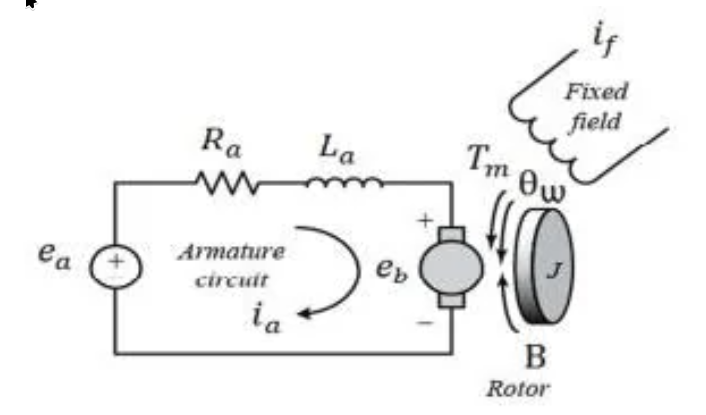
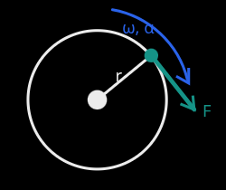
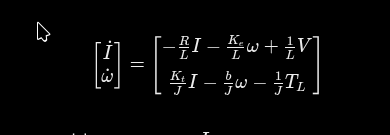
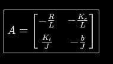
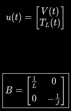
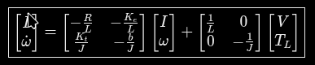

## DC motor electric equasion

With the 2nd Kirghoff law:

V(t) = Vr(t)+Vl(t)+E(t)

R - Armature Resistance
L - Armature Inductance
E - Back EMF
V - Applied Voltage

With the Ohm law

Vr(t) = RI(t)

And for inductance:

Vl(t) = L*dI(t)/dt

Back EMF:

E(t) = Ke*ω(t)

The first differential motor equasion:

V(t) = RI(t) + LdI(t)/dt + Keω(t)

## Mechanical Model

T = rF
∑T = Jα

α = Jdω/dt

∑T = Jdω/dt

There  are three torques that applied to the rotor

#### Electromagnetic Torque

Tm = Kt*I

#### Load Torque

Add later

#### Friction Torque

Begin with viscous friction

Tf = bω

#### Conclusion

∑T = Tm-Tf-Tl

Jdω/dt = Kt*I -bω - Tl

dω/dt = (Kt*I -bω - Tl)/J

## State-Space Representation

Matrix A

Matrix B

The full model:

Matrix C and D

For now only 

y(t) = ω(t)

But x has I and ω, so 

C = [0 1]

and  D = [0 0]

